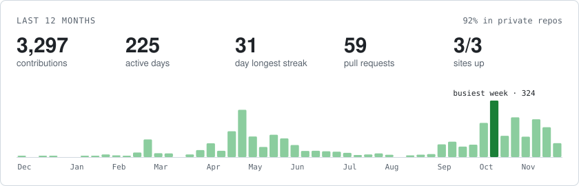

### Hi, I’m Nelson 👋

Backend engineer at Spotify in London, originally from Corrientes, Argentina. After hours I build small products and keep them running.

<a href="https://github.com/nelsongallardo/nelsongallardo/blob/main/scripts/build.py">
  <picture>
    <source media="(prefers-color-scheme: dark)" srcset="assets/activity-dark.svg">
    
  </picture>
</a>

#### In production

| Service | What it is | Status | Response | Uptime (30 days) |
|---|---|---|--:|--:|
| [derabona.club](https://derabona.club/) | Guess the footballer from their club career · [code](https://github.com/nelsongallardo/guess-the-player) | 🟢&nbsp;Up | 196&nbsp;ms | tracking since 24 Nov |
| [cuiz-ai.com](https://cuiz-ai.com/) | Turns your notes into quizzes and flashcards | 🟢&nbsp;Up | 177&nbsp;ms | tracking since 24 Nov |
| [tubesoundquiz.com](https://tubesoundquiz.com/) | Which Tube line sounds like this? · [code](https://github.com/nelsongallardo/tube-quiz) | 🟢&nbsp;Up | 390&nbsp;ms | tracking since 24 Nov |

Checked hourly by a GitHub Action · last run 28 Nov 2026, 03:19 UTC · [how this page is built](https://github.com/nelsongallardo/nelsongallardo/blob/main/scripts/build.py)

#### Other things I’ve built

- [kindle-dash](https://github.com/nelsongallardo/kindle-dash): a jailbroken Kindle turned into a morning newspaper
- [nstack](https://github.com/nelsongallardo/nstack): rules I got tired of repeating to coding agents
- [phog-cli](https://github.com/nelsongallardo/posthog-cli): PostHog from the terminal
- [tab-router](https://github.com/nelsongallardo/firefox-tab-router): sends every link to its Firefox tab group
