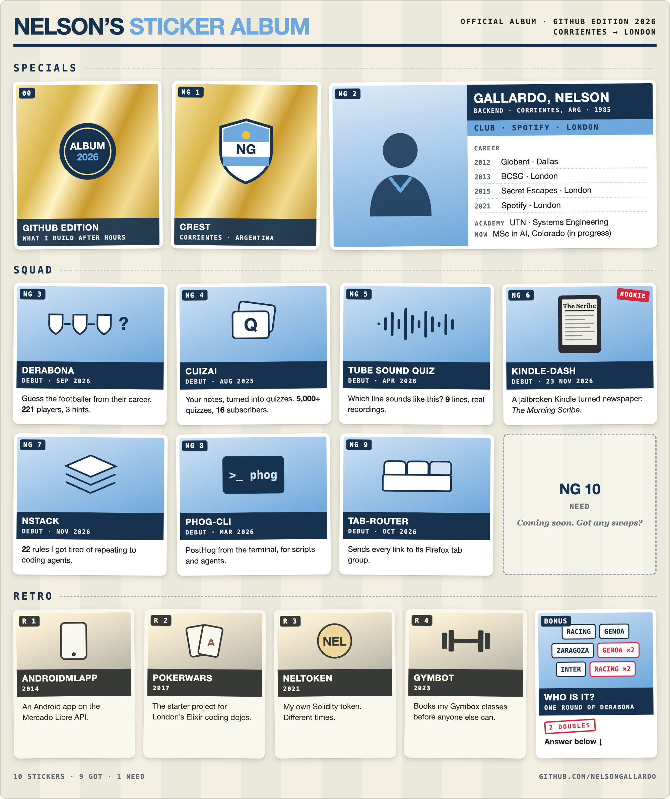

I’m Nelson, a backend engineer from Corrientes, Argentina, living in London. These are the things I build after hours.

## Squad

| | Sticker | What it is |
|---|---|---|
| NG 3 | [derabona](https://derabona.club/) | Guess the footballer from their club career. [Code](https://github.com/nelsongallardo/guess-the-player) |
| NG 4 | [CuizAI](https://cuiz-ai.com/) | Turns your notes into quizzes and flashcards |
| NG 5 | [Tube Sound Quiz](https://tubesoundquiz.com/) | Which Tube line sounds like this? [Code](https://github.com/nelsongallardo/tube-quiz) |
| NG 6 | [kindle-dash](https://github.com/nelsongallardo/kindle-dash) | A jailbroken Kindle turned into a morning newspaper |
| NG 7 | [nstack](https://github.com/nelsongallardo/nstack) | Rules I got tired of repeating to coding agents |
| NG 8 | [phog-cli](https://github.com/nelsongallardo/posthog-cli) | PostHog from the terminal |
| NG 9 | [tab-router](https://github.com/nelsongallardo/firefox-tab-router) | Sends every link to its Firefox tab group |
| NG 10 | *Need* | Coming soon. Got any swaps? |

## Bonus sticker

Who went **Racing → Genoa → Zaragoza → Genoa → Inter → Racing**?

Flip it

**Diego Milito.** Both goals in the 2010 Champions League final.

